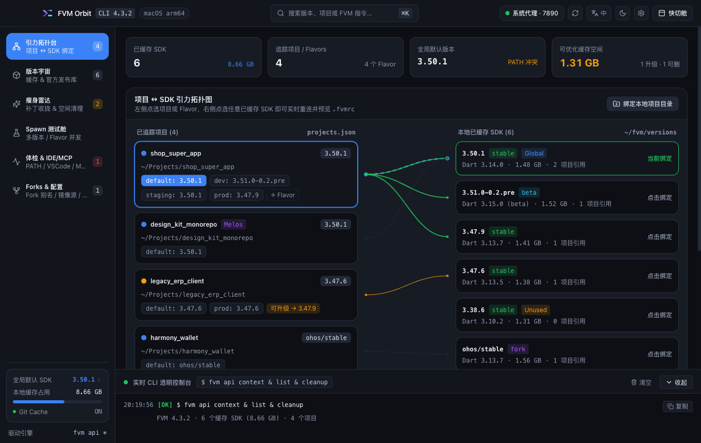
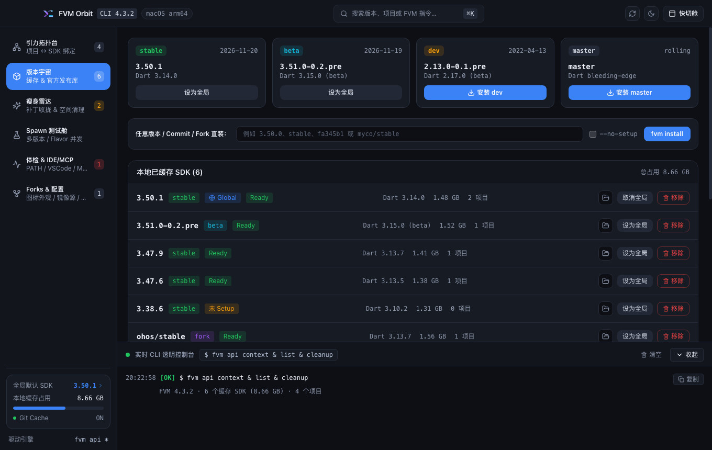
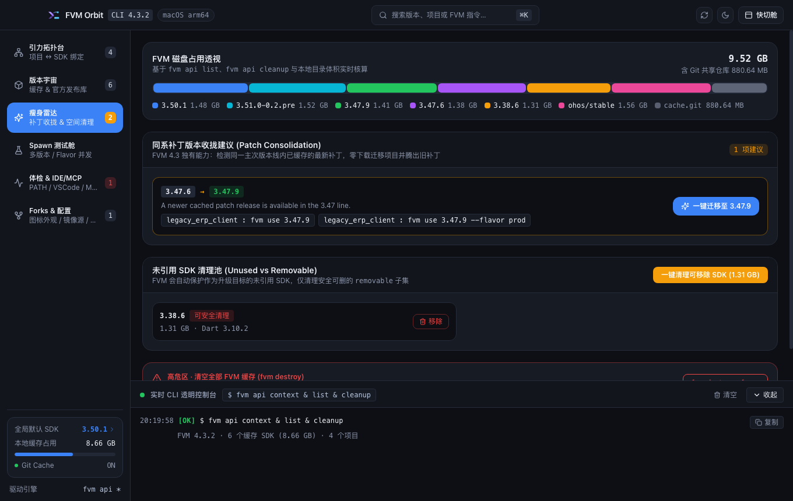

<div align="center">
  

  <h1>FVM Orbit</h1>

  <p>
    <strong>Native macOS Desktop Spatial Cockpit & Menu Bar Switcher for <a href="https://github.com/btwld/fvm">btwld/fvm</a></strong>
  </p>

  <p>
    Built with <strong>Tauri v2 + Rust + React 19 + TypeScript + Tailwind CSS v4</strong>. Directly powered by your local <code>fvm</code> CLI and <code>fvm api</code> JSON engine — zero black-box lock-in, zero invasive config, and a ~9 MB bundle footprint.
  </p>

  <p>
    <a href="https://hanklee9820.github.io/fvm-orbit/"><strong>Official Website & Docs (EN / 中)</strong></a>
    &nbsp;·&nbsp;
    <a href="https://github.com/hanklee9820/fvm-orbit/releases"><strong>Download Releases</strong></a>
    &nbsp;·&nbsp;
    <a href="https://github.com/btwld/fvm"><strong>btwld/fvm Repository</strong></a>
    &nbsp;·&nbsp;
    <a href="https://fvm.app/documentation/getting-started/overview"><strong>Official FVM Docs</strong></a>
  </p>

  <p>
    <a href="README.md"><strong>简体中文</strong></a>
    &nbsp;·&nbsp;
    <strong>English</strong>
  </p>
</div>

---

## Why FVM Orbit (Relationship with [btwld/fvm](https://github.com/btwld/fvm))

[FVM (Flutter Version Management)](https://github.com/btwld/fvm) is the standard multi-version CLI manager in the Flutter ecosystem, binding exact Flutter SDK versions, flavor environments, and custom forks per project.

**FVM Orbit is the native visual desktop companion for `btwld/fvm`**:

- **100% Native CLI Driven, Zero Config Lock-in**: Never reinvents FVM conventions. Every snapshot is read directly from `fvm api context / list / releases / project / cleanup`, and every mutation spawns your real `fvm` binary following standard `.fvmrc` and `~/fvm/versions` layouts.
- **Transparent Streaming CLI Console**: Every click in the GUI streams the exact `fvm ...` command and live `stdout/stderr` logs in the bottom console, with one-click command copy and instant process cancellation.
- **Two-Way Terminal Sync**: Built-in Rust `notify` filesystem watcher automatically refreshes the GUI and topology graph whenever you run `fvm use` or `fvm install` in an external terminal.
- **Full-Stack Internationalization (i18n)**: Native **Follow System / English / 简体中文** support across all React workspaces, the native macOS top application menu, the system menu bar tray, and Rust backend diagnostics.

---

## Interface Preview

### Topology Studio (Dark / Light / Follow System)

<p align="center">
  <picture>
    <source media="(prefers-color-scheme: dark)" srcset="docs/images/app-topology-dark.png" />
    <source media="(prefers-color-scheme: light)" srcset="docs/images/app-topology-light.png" />
    
  </picture>
</p>

<table>
  <tr>
    <td width="50%">
      <picture>
        <source media="(prefers-color-scheme: dark)" srcset="docs/images/app-releases-dark.png" />
        <source media="(prefers-color-scheme: light)" srcset="docs/images/app-releases-light.png" />
        
      </picture>
      <p align="center"><sub>Releases · Official Channels, Commit Hashes & Custom Fork Installer</sub></p>
    </td>
    <td width="50%">
      <picture>
        <source media="(prefers-color-scheme: dark)" srcset="docs/images/app-cleanup-dark.png" />
        <source media="(prefers-color-scheme: light)" srcset="docs/images/app-cleanup-light.png" />
        
      </picture>
      <p align="center"><sub>Cleanup Radar · Disk Footprint, Zero-Download Patch Consolidation & Pruning</sub></p>
    </td>
  </tr>
  <tr>
    <td width="50%">
      
      <p align="center"><sub>Light Mode · Automatically Adapts to macOS Appearance</sub></p>
    </td>
    <td width="50%" valign="middle">
      <div align="center">
        
        &nbsp;&nbsp;&nbsp;
        
        <p><sub>Native macOS Craft · Instant EN/中 Language Toggle, Dual Dock Icons, <code>⌘,</code> Settings (Proxy / Icon / Language), Menu Bar Tray, Resizable Live CLI Console & <code>⌘K</code> Command Palette</sub></p>
      </div>
    </td>
  </tr>
</table>

---

## Core Modules & FVM CLI Capability Mapping

| Module | Underlying `btwld/fvm` Command | Visual & Interactive Highlights |
| --- | --- | --- |
| **Topology Studio** | `fvm use` / `fvm api project` | Tracked projects & flavor slots on the left, cached SDKs on the right, pixel-accurate SVG Bézier links in between; native directory picker, live `.fvmrc` preview, and `--pin` / `--skip-pub-get` / `--skip-setup` / `--force` toggles |
| **Releases Explorer** | `fvm releases` / `fvm install` / `fvm global` / `fvm remove` | 4 channel spotlight cards (`stable / beta / dev / master`), commit hash & custom fork installation (`--no-setup`), 1-click set global, and reveal in Finder |
| **Cleanup Radar** | `fvm cleanup` / `fvm api cleanup` / `fvm destroy` | Exact disk footprint for every cached SDK and `cache.git`; 1-click FVM 4.3 **zero-download minor patch consolidation**, separating protected upgrade targets from safely removable SDKs |
| **Spawn Matrix** | `fvm spawn` / `fvm flavor` / `fvm exec` | Rust Tokio concurrent runner across multiple Flutter SDKs or project flavors with side-by-side streaming output, duration comparison, and instant cancellation |
| **Doctor & IDE / MCP** | `fvm doctor` / `fvm api context` | Detects login shell `$PATH` shadowing against `~/fvm/default/bin` with backed-up `~/.zshrc` auto-repair; inspects VS Code / IntelliJ `.idea` / Melos and copies **Dart MCP Server** config JSON |
| **Forks & Global Config** | `fvm fork` / `fvm config` | Manage custom Flutter fork aliases, switch Git mirror URLs (GitHub / Tsinghua TUNA), and toggle Git Reference Cache |
| **Settings (`⌘,`) & Proxy** | `HTTP_PROXY` / `HTTPS_PROXY` / `ALL_PROXY` injection | **Direct Mode** (clears proxy env vars & sets `NO_PROXY=*`), **macOS System Proxy** (`scutil --proxy` detection), and **Custom HTTP/HTTPS/SOCKS5 Proxy** (with Clash/Surge/V2Ray presets & latency test), plus Dock Icon & Language preferences |
| **Full-Stack i18n** | Frontend UI + Native Menu + Tray + Rust Backend | **Follow System (`NSLocale`) / English (`en-US`) / 简体中文 (`zh-CN`)**; switch instantly via the Title Bar `EN/中` button, `⌘,` Settings, or `⌘K` Command Palette with live macOS menu bar & tray rebuild |
| **Native macOS Integration** | All high-frequency actions | Persistent Menu Bar Tray for 1-second global SDK switching, `⌘K` Command Palette, System/Light/Dark themes, and a vertically resizable live CLI console |

---

## Internationalization (i18n) Support

FVM Orbit ships with a **full-stack English & Simplified Chinese internationalization engine** spanning the React frontend, native macOS window chrome, and the Rust backend:

- **Supported Locales & Auto-Detection**:
  - **`Follow System` (Default)**: On launch, the Rust backend inspects macOS `NSLocale.preferredLanguages()` (with `LC_ALL` / `LC_MESSAGES` / `LANG` fallback) to automatically match your OS language.
  - **`English (en-US)`** / **`简体中文 (zh-CN)`**: Lock your preferred language explicitly. Preferences are persisted in `language.txt` inside the app config directory (and mirrored to `localStorage` for zero-flicker startup).
- **Three Instant Switching Entry Points**:
  1. **Title Bar Quick Toggle**: Click the language pill (`EN` / `中`) in the top-right title bar to toggle between English and Chinese in one click.
  2. **Settings Modal (`⌘,`)**: Press `⌘,` (or click the gear icon / `FVM Orbit → Settings…` in the macOS menu bar) and open the **Interface Language** tab to choose `Follow System`, `简体中文`, or `English`.
  3. **Command Palette (`⌘K`)**: Press `⌘K` and type `lang`, `English`, `Chinese`, or `语言` to switch from the keyboard.
- **Full-Stack Live Synchronization (No Restart Required)**:
  - **React Frontend**: All six workspaces, Quick Switch popover, Settings modal, `⌘K` Command Palette, live CLI console, and toast notifications update immediately with compile-time TypeScript dictionary key checking.
  - **Native macOS App Menu**: Tauri dynamically rebuilds the top macOS application menu bar (`About FVM Orbit / Settings… / File / Edit / View / Window` ↔ `关于 FVM Orbit / 设置… / 文件 / 编辑 / 显示 / 窗口`).
  - **macOS Menu Bar Tray**: The persistent menu bar tray items, global SDK status header, and tray icon tooltip update in place.
  - **Rust Backend Diagnostics**: Proxy environment injection banners, connectivity latency reports, `$PATH` repair messages, and CLI error diagnostics automatically localize to the active language.

---

## Download (Releases)

Pre-built binaries for **macOS** and **Windows** are available on **[GitHub Releases](https://github.com/hanklee9820/fvm-orbit/releases)**:

| Platform | Architecture | Installer Formats |
| --- | --- | --- |
| **macOS** | Apple Silicon (`aarch64` / M1–M4) | `.dmg` / `.app.tar.gz` |
| **macOS** | Intel (`x86_64`) | `.dmg` / `.app.tar.gz` |
| **Windows** | 64-bit (`x64`) | `-setup.exe` (NSIS) / `.msi` (WiX) |
| **Windows** | ARM64 (`aarch64`) | `-setup.exe` (NSIS) |

---

## Prerequisites

Make sure [btwld/fvm](https://github.com/btwld/fvm) (`>= 4.0` recommended for full `fvm api` JSON and `fvm cleanup` support) is installed on your Mac:

```bash
# macOS (Homebrew)
brew tap leoafarias/fvm
brew install fvm

# Verify installation
fvm --version
```

---

## Local Development & Packaging

Requires Node.js (`>= 20` recommended), `pnpm`, and the Rust toolchain:

```bash
# Clone the repository
git clone https://github.com/hanklee9820/fvm-orbit.git
cd fvm-orbit

# Install frontend dependencies
pnpm install

# Launch Tauri desktop app in hot-reload dev mode
pnpm tauri:dev

# Run frontend TypeScript check & production build
pnpm build

# Package native macOS .app / .dmg
pnpm tauri:build

# Bump version, push v* tag & trigger GitHub Actions cross-platform release
pnpm release patch          # or pnpm release minor / pnpm release 0.2.0
```

---

## Acknowledgements

- [btwld/fvm](https://github.com/btwld/fvm) — Powerful Flutter Version Management CLI & JSON API
- [Tauri v2](https://v2.tauri.app/) — Lightweight, secure, native Rust desktop application framework
